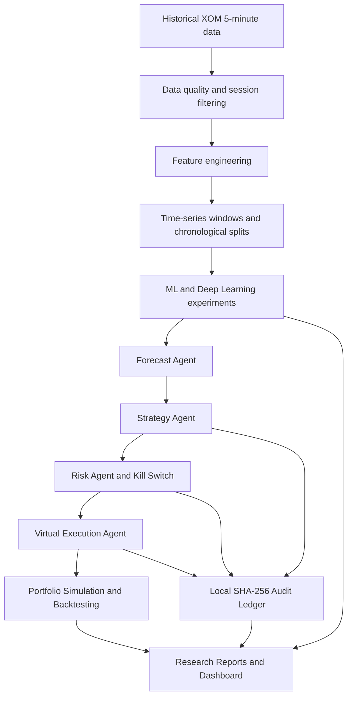

# AURUM-AI V5

**Autonomous AI-Powered Financial Research & Investment Simulation Platform**

[](#development-environment)


**Author:** Khalid El Mesri  
**Project:** AURUM-AI V5  
**Scope:** Historical Exxon Mobil Corporation (**XOM**) market data; machine learning, autonomous decision agents, risk controls, backtesting, and research traceability.

> **Research disclaimer:** AURUM-AI V5 is an educational and experimental platform. All portfolio actions are simulated. It does not place real orders, manage real funds, provide investment advice, or establish a profitable trading strategy.

## Overview

AURUM-AI V5 combines a Python financial time-series research workflow with a 19-module graphical application. Its purpose is to investigate how predictive models, autonomous agents, risk rules, portfolio simulation, and auditability can be integrated in one system.

The project covers the workflow from **historical five-minute XOM observations** to data quality controls, feature engineering, model evaluation, agent decisions, risk management, and simulated execution. A Windows desktop distribution is built with **PyInstaller** and **Inno Setup**.

**Important:** Despite its name, AURUM-AI V5 studies **XOM stock market data**, not gold (XAU/USD), and the simulations do not trade real markets.

## Key Features

- Historical data ingestion, market-session filtering, and quality analysis.
- Chronological train/validation/test separation and time-series feature engineering.
- Forecasting experiments with **LSTM, GRU, CNN1D, TCN, Transformer, and XGBoost**.
- Multi-horizon research across **5, 15, 30, and 60 minutes**.
- Autonomous forecast, strategy, risk, and virtual execution agents.
- Portfolio simulation, NYSE-calendar backtesting, stress testing, and what-if analysis.
- Historical risk-control experiments, including a **Kill Switch**.
- Local SHA-256 hash-chained audit ledger and explorer.
- Digital Twin, experiment tracking, research library, and report export.
- Windows-oriented graphical application, login interface, and installer workflow.

## Application Modules (19)

| Area | Modules |
| --- | --- |
| Overview | **1.** Executive Dashboard |
| Market & AI | **2.** Market Analysis · **3.** Data Quality · **4.** Feature Engineering · **5.** AI Prediction · **6.** AI Model Lab |
| Autonomous Intelligence | **7.** Autonomous Agents · **8.** Agent Decision Room · **9.** Digital Twin |
| Portfolio & Risk | **10.** Portfolio Simulator · **11.** Risk Management · **12.** Backtesting — NYSE V3 · **13.** Stress Testing · **14.** What-If Simulator |
| Blockchain & Audit | **15.** Blockchain Ledger · **16.** Blockchain Explorer |
| Research Center | **17.** Library · **18.** Experiments · **19.** Reports |

## System Architecture



All agent decisions and executions described here are **simulated**; this diagram is a functional research architecture, not a production trading system.

## Data Engineering

The principal research pipeline is:

```text
data/
├── 01_raw/          # Original historical source data (not committed)
├── 02_clean/        # Validated / session-filtered data (not committed)
├── 03_features/     # Engineered features (not committed)
├── 04_windows/      # Time-series windows / labels (not committed)
├── 05_model_data/   # Model-ready datasets (not committed)
└── metadata/        # Data provenance metadata, where available
```

The historical XOM dataset spans portions of **2017–2026**. An earlier audit identified approximately **504,763 raw rows** and **161,023 rows** after market-hours filtering. This does **not** imply continuous or gap-free coverage.

Research precautions include chronological splitting, avoiding future information in model inputs, and fitting preprocessing transforms on training data rather than on the held-out test set.

## Predictive Models and Scientific Evaluation

Models explored in this project include **LSTM, GRU, CNN1D, TCN, Transformer, and XGBoost**. The final independent NYSE-calendar test evaluated preselected model/horizon combinations against a simple **Zero Return** reference (a prediction of no price return).

### Final held-out evaluation

**Reported test period:** 15 November 2024 – 30 September 2026 (**311 NYSE sessions** in the evaluated sample). The final test was not used to retrain the selected models.

| Horizon | Selected model | Test samples | Model MAE | Zero Return MAE | Better than baseline? |
| --- | --- | ---: | ---: | ---: | --- |
| 5 min | CNN1D | 14,784 | 0.0007530153 | 0.0007529265 | No |
| 15 min | CNN1D | 14,162 | 0.0012760679 | 0.0012753215 | No |
| 30 min | CNN1D | 13,229 | 0.0017962496 | 0.0017862006 | No |
| 60 min | LSTM | 11,363 | 0.0024988111 | 0.0024870468 | No |

**Interpretation:** None of the four selected models beat Zero Return on **MAE** in this final test. The observed differences are small for some horizons, but they do not establish predictive improvement or trading profitability.

Reported evaluation artifact: `artifacts/evaluations/nyse_v3_final_test_v1/final_test_report.json` (availability in a public checkout depends on the final publication selection).

### Historical portfolio simulations

The following results refer to **validation-history simulations**, not independent test profits or live trading:

| Strategy horizon | Starting capital | Ending capital | Net return after fees | Trades |
| --- | ---: | ---: | ---: | ---: |
| 30 min | $10,000.00 | $9,915.44 | **−0.85%** | 94 |
| 60 min | $10,000.00 | $9,930.65 | **−0.69%** | 90 |

Trading costs materially affect results. Removing assumed execution costs in separate sensitivity scenarios can change simulated net returns, but **does not demonstrate a validated profitable strategy**.

## Risk Management and Auditability

- **Historical Kill Switch test:** A risk-control scenario reached approximately **10.0042% drawdown**, transitioned from `ACTIVE` to `HALTED`, simulated emergency liquidation, and blocked subsequent trading decisions. This was a **historical simulation**, not live production monitoring.
- **Blockchain ledger:** A local SHA-256 hash chain was validated in one audited state containing **223 blocks** and **222 events**. It is an **integrity-oriented local audit log**, *not* a decentralized or public blockchain.
- **Research integrity:** A focused set of **20 checks** (temporal integrity and training guards) passed during project validation. This is not a claim that all possible system or security tests have been performed.

## Repository Layout

The source tree includes these principal components:

```text
AURUM-AI-V5/
├── agents/             # Agent logic
├── artifacts/          # Selected experiment and evaluation outputs
├── assets/             # Application resources
├── backend/            # Backend components
├── backtesting/        # Historical simulation and backtesting logic
├── blockchain/         # Local audit ledger
├── config/             # Configuration
├── data/               # Research data pipeline directories
├── data_engineering/   # Preparation and feature workflows
├── database/           # Database-related code
├── deep_learning/      # Model training and inference research
├── docs/               # Project and desktop-distribution documentation
├── frontend/           # User interface components
├── installer/          # Windows installer sources
├── portfolio/          # Portfolio simulation components
├── reports/            # Selected analyses and research outputs
├── risk/               # Risk-control logic
├── scripts/            # Utility and workflow scripts
├── tests/              # Automated tests
├── tools/              # Development utilities
├── pyproject.toml
└── README.md
```

Not all generated data, trained checkpoints, binary installers, and local databases are distributed through Git. The source archive and the Windows installer are distinct deliverables.

## Development Environment

- **Python:** 3.11 (`>=3.11,<3.12` in the current `pyproject.toml`)
- **Core declared dependencies:** NumPy, pandas, PyArrow, SciPy, Pydantic
- **Declared development extras:** pytest, Ruff
- **Other application technologies used across the project:** PyTorch, scikit-learn, FastAPI, Streamlit, Plotly, SQLite, PyInstaller, Inno Setup

> **Dependency status:** The current `pyproject.toml` declares only the core dependencies and development extras. It does **not yet declare every dependency** needed to run the full graphical application, model workflows, or Windows build. Full reproducible installation instructions must be finalized before calling the repository ready-to-run.

### Set up the declared core environment (Windows PowerShell)

```powershell
py -3.11 -m venv .venv
.\.venv\Scripts\Activate.ps1
python -m pip install --upgrade pip
python -m pip install -e ".[dev]"
```

This prepares the **declared core project environment**. It does not automatically install all optional or currently undeclared application dependencies. Some tests and application entry points may require additional setup, data, or checkpoints. Refer to `docs/` and the relevant module scripts; do not assume that a clone alone reproduces the full desktop application.

## Windows Desktop Distribution

AURUM-AI V5 has been packaged for Windows using **PyInstaller** with an **Inno Setup** installer workflow. The desktop installer is a distribution artifact and is not the same as the Python source repository.

The application is **not published on Microsoft Store**. Do not interpret the professional Windows-style interface as a store listing.

## Reproducibility and Known Limitations

1. **Historical research only:** no real-money trading, brokerage connectivity, or guaranteed financial returns.
2. **Prediction baseline:** the evaluated final models did not improve MAE over Zero Return.
3. **Portfolio validation:** the reported post-fee simulation outcomes are negative and are not held-out trading performance.
4. **Dataset availability:** raw/processed datasets and large model checkpoints are intentionally excluded from ordinary Git tracking; external access or regeneration may be required.
5. **Dependency coverage:** the present package metadata does not yet include every runtime/build dependency.
6. **Audit ledger:** the hash chain provides local integrity checks; it is not a distributed consensus network.
7. **Time coverage:** historical observations do not imply uninterrupted intraday or calendar coverage.

## Documentation

Project notes currently include:

- `docs/CHECKLIST_DESKTOP_PHASE22.md`
- `docs/PHASE25_PLAN_VALIDATION.md`
- `docs/README_PHASE22_1.txt`
- `docs/README_PHASE23_INSTALLER.md`

Screenshots of the application and the final installation guide can be added once the files are reviewed for personal information and committed to a dedicated documentation folder.

## Author

**Khalid El Mesri**  
GitHub: [@khalid-el-mesri](https://github.com/khalid-el-mesri)

## Disclaimer and Licensing

This project is for **academic research and education only**. Its findings are not financial advice. Simulated performance does not predict live performance.

**License:** No open-source license is currently included in this repository. All rights are reserved unless an explicit license is added by the author. Please contact the author before reusing or redistributing the source code.
